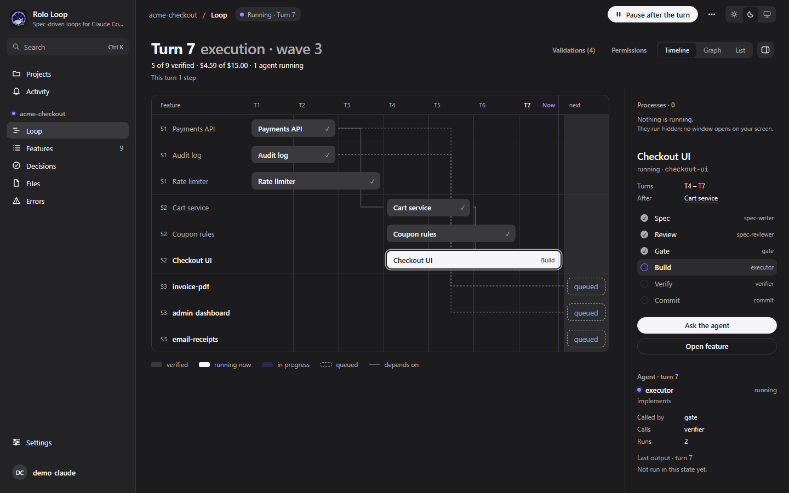
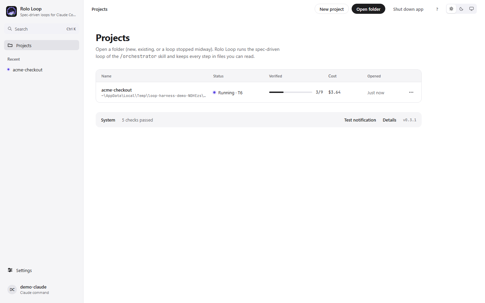
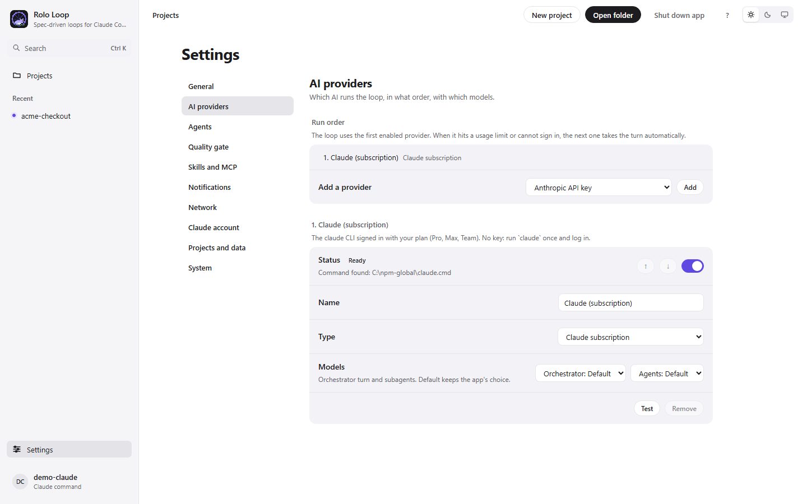
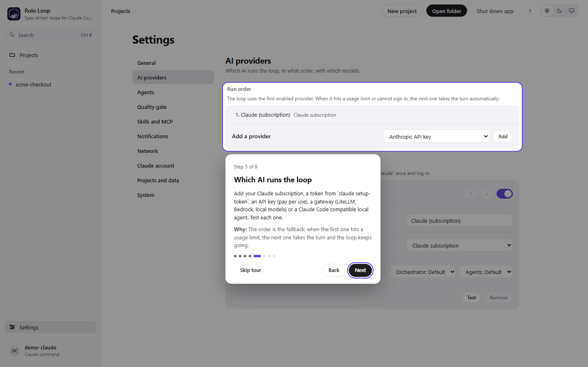

<p align="center">
  
</p>

<h1 align="center">Rolo Loop</h1>

<p align="center"><strong>Unattended, spec-driven build loops for Claude Code, on your own subscription.</strong></p>

> Status: under construction. This is a ground-up Rust rebuild; nothing is released yet.

**Meet Rolo.** A hamster in its wheel runs without leaving the place and starts again at every turn: that is a loop. Rolo Loop puts that wheel to work. You describe a goal and approve a plan; a planner splits the work into features; sub-agents write each feature's spec, review it, build it, verify it and pass it through a quality gate inside an isolated git worktree; a guard hook keeps every tool call inside the lines you drew. Turn after turn, until the roadmap is done. You follow it from the desktop app (or a local web panel) and answer when the loop asks.

<p align="center">
  
  
</p>
<p align="center">
  
  
</p>

## What is in the box

- A Claude Code plugin: the `orchestrator` skill, three satellite skills (audit dependencies, create a block rule, show the progress graph), the `repo-catalog` skill and seven sub-agents (`spec-writer`, `spec-reviewer`, `executor`, `quality-gate`, `verifier`, `verifier-flow`, `brownfield-mapper`).
- `harness`, one Windows binary: the loop engine, the local panel server and the command line.
- `guard`, the hook binary Claude Code runs before every tool call.
- The panel: a small Preact app served on `127.0.0.1`, shown by the desktop app (or a browser with `harness serve --no-desktop`).

## How it works

1. In Claude Code, the orchestrator skill maps your code, writes `.specs/project/ROADMAP.md` (a typed graph of features with dependencies, stages and paths) and stops.
2. In the panel you read the graph, run the preflight and approve. Approval is a click; no agent can do it for you.
3. The loop runs turns of `claude -p`. Each turn takes the features that are ready and runs six steps for each: spec, review, gate, execute, verify, commit. State is in files, so a stopped loop resumes.
4. When something needs you (a choice, a blocked action), the loop stops and asks in the panel.
5. Deliver pushes the feature branch and opens the pull request. It is the only push there is.

More in [docs/HOW_TO_USE.md](docs/HOW_TO_USE.md); every setting in [docs/CONFIG.md](docs/CONFIG.md). The architecture is in [docs/ARCHITECTURE.md](docs/ARCHITECTURE.md), the panel API in [docs/API.md](docs/API.md), and how the skill finds the app in [docs/SKILL_BRIDGE.md](docs/SKILL_BRIDGE.md).

## Requirements

- Windows 10 or 11, `git`, and the `claude` CLI signed in to your account.
- The companion plugin [claude-craft-kit](https://github.com/iagopadilha/claude-craft-kit) (version 0.3.x) for the dev skills and the `craft` tools.

## Try it without touching anything

```
harness demo
```

Opens the panel on a fictional project with moving data. It never calls `claude` and removes its files when you stop it.

## Limits, honestly

- Loops spend your Claude subscription usage; long loops can reach a usage window and then wait for the reset.
- The loop runs on the `claude` command only (one account): a usage limit waits for the reset.
- Only the feature branch is ever pushed. Protected branches are never touched by the loop.
- The guard is text analysis of commands, not a sandbox: a program that builds its target at run time is judged only by the run-time network layer, not by the guard. Read the residual-risk notes in `plugin/skills/orchestrator/hooks/README.md`.
- Windows only for now.

## Install

Download `Rolo Loop_<version>_x64-setup.exe` from the releases and run it (per user, no admin; an `.msi` exists for managed machines). It installs the app (Start menu: **Rolo Loop**), puts `harness` on your PATH and carries the plugin. Then, in Claude Code:

```
/plugin marketplace add "%LOCALAPPDATA%\Rolo Loop"
/plugin install rolo-loop@rolo-loop
```

(or `/plugin marketplace add iagopadilha/rolo-loop` from GitHub) and `harness doctor` in a new terminal. The first start opens a guided tour of the settings. Details, signing and updates: [docs/INSTALLER.md](docs/INSTALLER.md).

## Build from source

```
cargo build --release
cargo test --workspace
cd crates/desktop && cargo tauri build     # the desktop app and its installers (needs tauri-cli 2.12)
```

The differential tools in `tools/` compare this build with the reference implementation (they need the reference clone, named in each tool's header).

## Not affiliated

This project is not affiliated with Anthropic. "Claude" and "Claude Code" name the products it works with.

## Licence

MIT, see `LICENSE`. Third-party notices are in [THIRD_PARTY.md](THIRD_PARTY.md).
